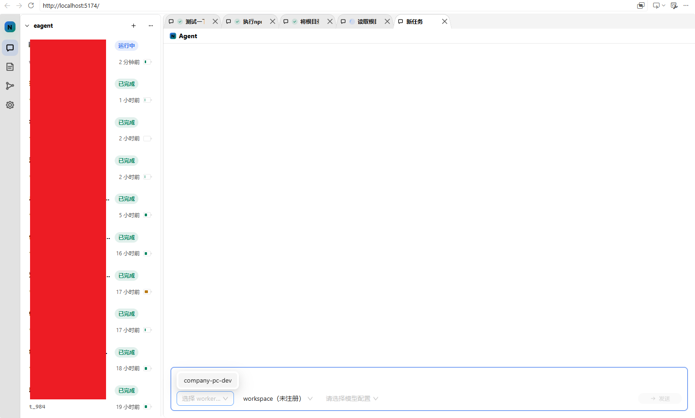
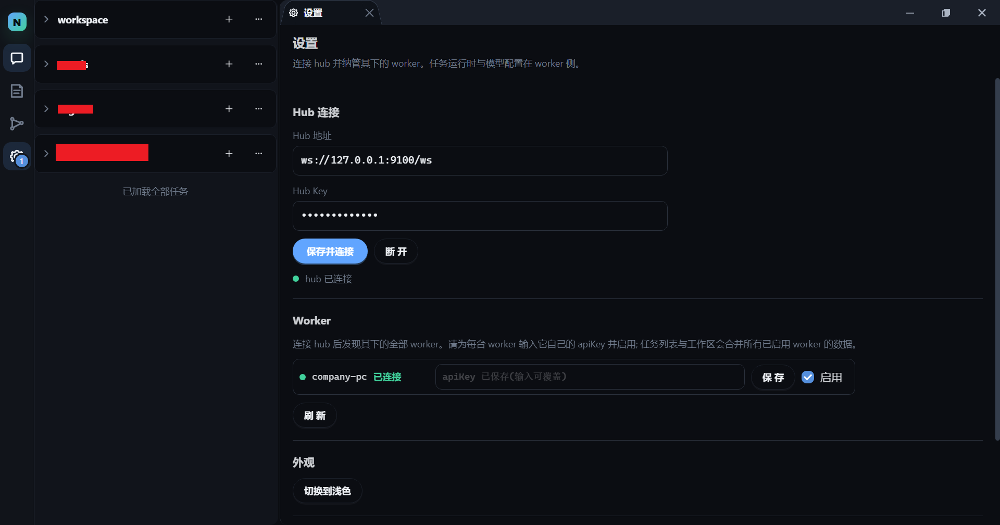
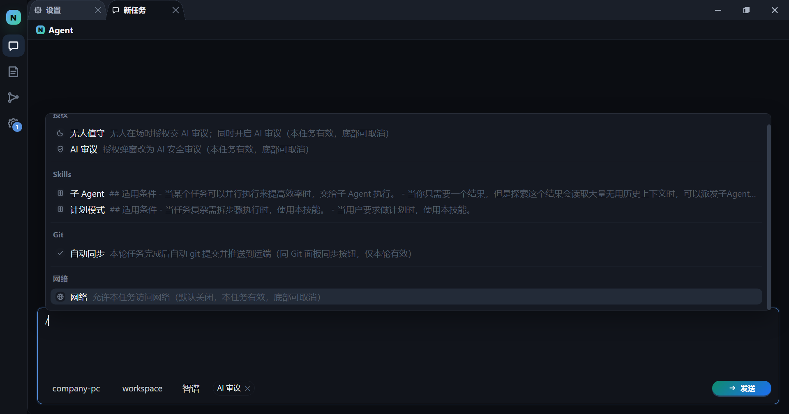
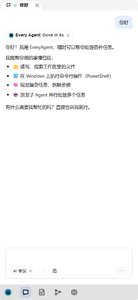
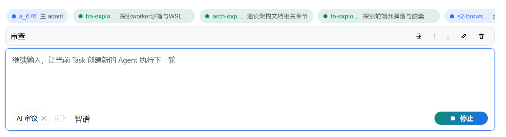
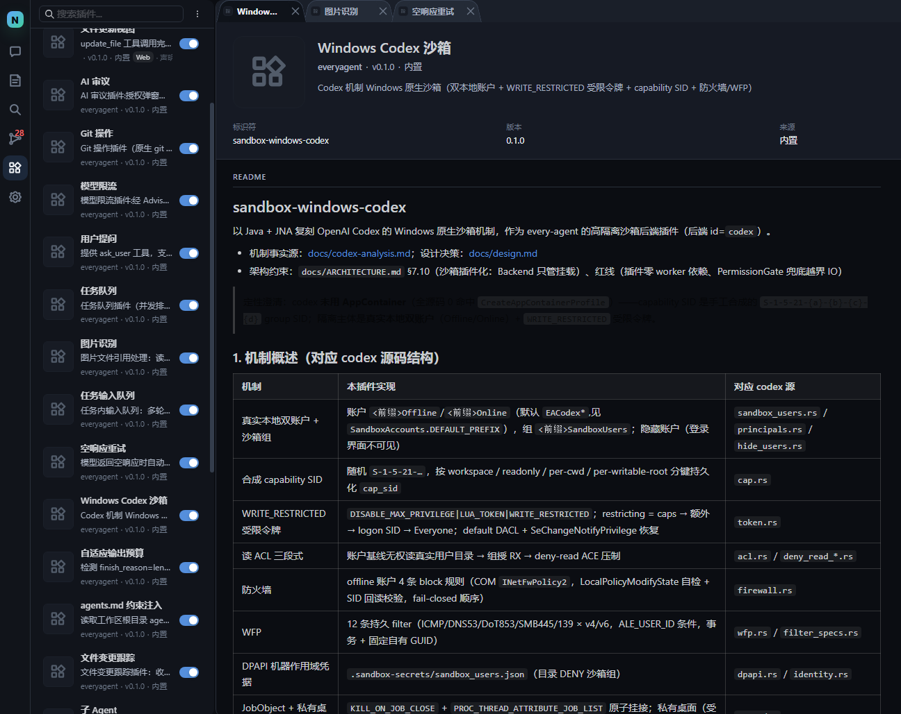

# Every Agent

> **An Agent you can use anywhere** — an open-source, self-hostable **remote AI agent control platform**: run AI tasks on your own PC, then check progress, continue the conversation, and answer its questions from a **phone, tablet, office computer, or any browser tab**.

<p align="center">
  
  
  
  
  
  
  
  
</p>

[简体中文](README.md) | **English**

## 📑 Table of Contents

- [✨ Highlights](#-highlights)
  - [🌍 Multi-device control — truly "usable anywhere"](#-multi-device-control--truly-usable-anywhere)
  - [🔒 Data never leaves your machine — dual-key authentication is safer](#-data-never-leaves-your-machine--dual-key-authentication-is-safer)
  - [📡 Resumable playback — progress is never lost](#-resumable-playback--progress-is-never-lost)
  - [🤖 Full AI visibility](#-full-ai-visibility)
  - [🛡️ Security sandbox + human-AI collaboration guardrails](#-security-sandbox--human-ai-collaboration-guardrails)
  - [🔌 Plug in any model, with built-in failover](#-plug-in-any-model-with-built-in-failover)
  - [🧱 Plugin-based architecture — everything is pluggable](#-plugin-based-architecture--everything-is-pluggable)
  - [🖥️ Desktop edition works out of the box](#-desktop-edition-works-out-of-the-box)
  - [🧩 Four modules, freely combinable for deployment](#-four-modules-freely-combinable-for-deployment)
  - [🏢 Intranet deployment for companies — integrate with existing systems with zero friction](#-intranet-deployment-for-companies--integrate-with-existing-systems-with-zero-friction)
- [🛡️ System-Level Sandbox: Codex-Inspired, Real Isolation](#-system-level-sandbox-codex-inspired-real-isolation)
- [📸 Screenshots](#-screenshots)
- [🏗️ Architecture Overview](#-architecture-overview)
- [🚀 Quick Start](#-quick-start)
  - [Option 1: Desktop Edition (recommended — zero dependencies · zero config)](#option-1-desktop-edition-recommended--zero-dependencies--zero-config)
  - [Option 2: Docker (self-host hub + worker + web)](#option-2-docker-self-host-hub--worker--web)
  - [Option 3: Build from source / development](#option-3-build-from-source--development)
- [⚙️ Configure Models (Required)](#-configure-models-required)
- [📱 Multi-Device Access (Core Scenario)](#-multi-device-access-core-scenario)
- [🛠️ Common Configuration Quick Reference](#-common-configuration-quick-reference)
- [🧩 Capabilities Overview](#-capabilities-overview)
- [📦 Tech Stack](#-tech-stack)
- [📄 License](#-license)
- [🙌 Contributing](#-contributing)

**Every Agent** is a "reachable from anywhere, executing locally" AI agent system — in one sentence: **your own agent, usable anywhere**.

- ✅ **Open source · free · self-hosted**: all code, files, and data stay on your own computer, never passing through any third-party server. Ideal for privacy-conscious individual developers and small teams.
- ✅ **Remote control without a public IP**: no need to worry about NAT, routers, or public IPs — the worker only needs to make one **outbound WebSocket** encrypted long connection, and browsers from all over the world can remotely control it (phone, tablet, office computer, Electron desktop).
- ✅ **Multi-device sync, resumable playback**: close the browser and the task keeps running; reopen it and the full history from start to current is visible, streaming continues, nothing is lost.
- ✅ **Built-in safety guardrails**: commands run in a sandbox, out-of-bounds operations require popup authorization, optional **AI review / unattended** auto-adjudication.
- ✅ **Plugin-based architecture — everything is pluggable**: sandboxes, git, model pool, sub-agents, and more (26 built-in plugins) all run on one plugin system — 15 backend + 12 frontend extension points, zero host-code changes; scaffold a new plugin in 5 minutes and install a `.eap` with one click from the Extensions panel.

**Tech keywords**: Spring Boot · Spring AI · Java 25 virtual threads · WebSocket · React · TypeScript · Electron · OpenAI-compatible models · model pool failover · multi-workspace · sub-agent orchestration · plugin system.

---

## ✨ Highlights

### 🌍 Multi-device control — truly "usable anywhere"
- The worker runs on your **home/office PC** and connects to a public hub via an **outbound WebSocket** — no need to worry about NAT, routers, or public IPs.
- **Desktop / mobile native adaptation**: the frontend has dedicated responsive designs for desktop and mobile. The desktop browser is a full multi-column workbench; the mobile UI auto-collapses sidebars and adapts to touch (long-press gestures, safe areas, breakpoint layouts). The same frontend works smoothly on both screens.
- **One frontend, multiple workers**: one at home + one at the office, unified in a single frontend to switch and operate by owner; all online workers under the hub can be managed.
- **One worker, multiple registered hubs**: the `worker.hubs` list can simultaneously connect to a public hub + an intranet/backup hub; the same tasks and files are visible across hubs, providing mutual redundancy.
- When the AI needs your confirmation, the question pops up synchronously on **all online frontends** — answer from whichever device you're on.

### 🔒 Data never leaves your machine — dual-key authentication is safer
- The hub is a **pure relay**: it stores nothing, understands nothing — it doesn't even know what a "task" is; it just forwards frames as-is.
- Task logs, files, git credentials, and model configs are all stored on the worker's local machine (`~/.everyagent/`). Network outages or hub downtime don't affect tasks continuing to completion.
- **Two independent keys, each governing its own domain**: the hub key controls "connecting to the hub," and the worker apiKey controls "manipulating this worker's data" — the two keys are independent and isolated per worker; leaking one doesn't compromise the whole system.

### 📡 Resumable playback — progress is never lost
- Real-time task stream increments are **directly pushed** via the stream channel; history/backfill is pulled via `task.poll` — both from the same source, deduplicated by seq.
- Close the browser, switch Wi-Fi, restart the hub: after reconnection it auto-re-subscribes and pulls backfill, making everything **fully visible from start to current**, then continues streaming.
- Tasks are **permanently retained** and only disappear when you actively delete them.

### 🤖 Full AI visibility
- Watch **token-by-token output, thinking process, tool calls, and file changes** in real time.
- Conversations are collapsible by "rounds"; expand to lazily load process details. Sub-agents are shown as a tree; concurrent multi-agent sessions don't lose frames.
- Per-round token usage and context consumption are clear at a glance.

### 🛡️ Security sandbox + human-AI collaboration guardrails
- Commands run in a **system-level sandbox** — not application-layer path checking, but **OS-level isolation**: Codex-style dual local accounts + restricted tokens; outside the workspace, the file system is physically read-only. Two pluggable backends (`sandbox-windows-codex` / `wsl-ubuntu`), switchable via one line of `worker.sandbox.type`. This is a true sandbox most coding agents don't have — see the [🛡️ System-Level Sandbox section](#-system-level-sandbox-codex-inspired-real-isolation) below.
- Out-of-workspace operations / dangerous commands always require **popup authorization**, with optional **AI review** / **unattended mode** for auto-adjudication; git credentials are AES-GCM encrypted and stored locally.

### 🔌 Plug in any model, with built-in failover
- Any **OpenAI-compatible** provider: OpenAI, DeepSeek, Qwen, GLM, local vLLM/Ollama… just click **Add** in the Settings page's Model Config table (built-in providers auto-fill endpoints), or change one line of config.
- **Model pool**: a task can be configured with multiple models; if the primary fails, it automatically switches to the next without interrupting the task.
- 💸 **A boon for free-model users**: the project was developed in its later stages entirely on **free models** — thanks to **SenseNova** for its generous free model quotas and to **OpenRouter** for its free model endpoints. Even when a free quota runs out or a model goes down, the model pool auto-switches to the next available one so development never stops. Today, Every Agent can **develop itself using Every Agent** (dogfooding).

### 🧱 Plugin-based architecture — everything is pluggable
- Many "core capabilities" you're using — sandboxes, git, model pool failover, sub-agents, context compression, AI review, unattended mode, task queues — are **not hard-coded in the host**; they are all implemented as plugins. The repo ships **26 built-in plugins**, each a living example you can copy from.
- **15 backend extension points** (tools / sandbox backends / Advisors / model enhancement / task lifecycle / custom RPC / slash commands) + **12 frontend UI extension points** (sidebar panels / workspace tabs / tool-call views / file editors / message actions…) — add capabilities to the whole system without touching a single line of hub / worker / web host code.
- **Three plugin forms**: Java-only / web-only / Java+web hybrid, decided by a single `plugin.json`; the `create-everyagent-plugin` scaffold gets your first plugin running in 5 minutes.
- Package as **`.eap`** and install with one click from the frontend "Extensions" panel (takes effect after a worker restart); plugins depend only on the lightweight `every-agent-plugin-api` and are class-loading-isolated via `URLClassLoader`, never touching worker internals.

> Full plugin development manual: **[docs/plugin-guide/](docs/plugin-guide/index.md)** (scaffold quick start, plugin.json fields, extension-point reference, build & distribution, troubleshooting).

### 🖥️ Desktop edition works out of the box
- Windows x64 **installer / portable edition**: bundles frontend + hub + worker + a slim JRE; double-click to use, no need to install Java / Node / Docker.

### 🧩 Four modules, freely combinable for deployment
The four modules — web / hub / worker / desktop — are **decoupled and each serves its purpose**. They can be built and deployed individually and combined freely:

- **Just want a single local machine** → use the desktop all-in-one bundle, ready out of the box.
- **Want public multi-device remote control** → run only hub + web on a public server, and run a worker separately on your own computer.
- **Worker is a first-class citizen** → one worker can register with **multiple hubs** simultaneously (`worker.hubs` list): connect to both a public hub and an intranet/backup hub; the same tasks and files are visible across hubs, providing mutual redundancy.
- **Desktop also supports multi-hub** → the worker bundled in the desktop edition is a full worker; just put the **remote entries** in the `worker.hubs` list of `~/.everyagent/application-worker.yaml` — on every worker start, the desktop generates `desktop/desktop-worker.yml`, **merging** the local entry (always `hubs[0]`, credentials sourced from the local hub) with your remote entries into the final hub list (loopback entries dropped, `${HUB_KEY:default}` placeholders resolved to literal defaults), so this "desktop worker" registers with both the local hub and the remote public hub — "out-of-the-box single machine" and "remote control from anywhere" hold simultaneously.

> Tip: Spring **replaces list properties like `worker.hubs` as a whole** across config files — when manually layering an override file via `--spring.config.additional-location`, you must rewrite the entire list in the override to keep existing entries; the desktop has already built the "local + user remote" merge into its startup flow (see [every-agent-desktop/README.md](every-agent-desktop/README.md)), so your file only needs the remote entries — no manual local entry required.

### 🏢 Intranet deployment for companies — integrate with existing systems with zero friction
- **A single server is all it takes**: deploy hub + worker inside the company, and employees simply open a browser to start using it — all data stays on the company's own servers and never leaves the intranet;
- **OA systems / mini-programs / WeCom (WeChat Work) can all plug in**: to upstream systems, the platform is just WebSocket + RPC (the protocol contract `every-agent-contract` is fully open); the web frontend is only "one of the official clients" — OA portals, office systems, mini-programs, and WeCom apps, any client that can speak WebSocket can integrate directly;
- **Auth is deliberately apikey-only — no user-account model**: the platform has no sign-up, no login, no user tables. When a company connects its existing user system (SSO / OA / WeCom), it only needs to map employee identities to apikeys at the integration layer — no need to migrate the user system into the platform, keeping integration cost minimal.

---

---

## 🛡️ System-Level Sandbox: Codex-Inspired, Real Isolation

Most coding agents either have no sandbox at all or rely on `cwd` locks + path-prefix validation as a "soft isolation" — this can't stop arbitrary writes after a `cd /`, nor can it prevent process escape. Every Agent is different: **the sandbox is system-level, enforced by the operating system's native mechanisms, not an application-layer simulation.**

> The approach is inspired by OpenAI Codex's dual-account + restricted-token design, using native OS capabilities on Windows for true process-level isolation.

### Why a "real sandbox" matters

| | Typical coding agent (no sandbox / soft isolation) | Every Agent (system-level sandbox) |
|---|---|---|
| Writes outside the workspace | Relies on path checks — a `cd` bypasses it | **Blocked at the OS level** — the process literally has no write permission outside |
| Process escape | No protection | Restricted tokens / separate distribution — attack surface drastically reduced |
| System files / user directories | AI can accidentally delete them | **Read-only** — accidental deletion is physically impossible |
| Recoverability | Leftover junk requires manual cleanup | WSL distro can be reinstalled in one step; host drives are invisible |

### Three pluggable sandbox backends — switch with one line of `worker.sandbox.type`

1. **`sandbox-windows-codex` (default)** — Codex-inspired native sandbox:
   - Dual local accounts: task processes run under a **dedicated low-privilege account**, physically isolated from your daily-use account;
   - **WRITE_RESTRICTED restricted token**: the process receives a "stripped" token — write privileges are stripped by the OS; outside the workspace directory, everything is **read-only**;
   - **Capability SID**: the process lacks sensitive capabilities and cannot initiate system-level operations;
   - Firewall / WFP rules can optionally tighten network access;
   - No WSL, no VM — pure Windows native mechanisms; fast startup, low overhead.

2. **`wsl-ubuntu`** — disposable full Linux sandbox:
   - Tasks run inside a **WSL2 Ubuntu distribution**; host Windows drives outside the workspace are **completely invisible**;
   - The distribution can be **fully reinstalled** (`wsl --unregister` → re-init) — use-and-discard, back to a clean state in one step;
   - The only backend that can **truly cut the network**: the in-task `/disable-network` command runs `unshare -n` inside the distro, physically isolating the network.

> When no sandbox plugin is present, the system falls back to `DIRECT` (running directly on the host), but the PermissionGate chain still intercepts out-of-bounds writes — **even if the user deliberately disables the sandbox, writes outside the workspace are not allowed** and must be authorized.

### Human-AI collaboration guardrails (on top of the sandbox)

The sandbox controls "can it write"; guardrails control "should it do this":

- Out-of-workspace path access / dangerous command verbs → **PermissionGate popup authorization**: reject / this round / this task (three levels);
- **AI review** can be enabled: the model automatically judges whether a dangerous operation is safe; falls back to human on timeout;
- **Unattended mode** can be enabled: authorization is fully auto-approved, ideal for long-running tasks when no one is watching;
- Git credentials are **AES-GCM encrypted** and stored locally, never transmitted over the network.

In one sentence: **the sandbox ensures the AI can't break your system; the guardrails ensure the AI doesn't do things you don't want it to do behind your back.**

---

## 📸 Screenshots
- Web frontend (connected to the same worker)

- Desktop app (connected to the same worker)

- Desktop app (connected to the same worker)

- Mobile (connected to the same worker)


- Sub-agents and task queue


- v1.0.0 plugin system + feature plugins
  

---

## 🏗️ Architecture Overview

```
[Home/Office LAN]                          [Public Server]
┌────────────────────┐   wss outbound conn   ┌──────────────────┐        ┌─────────────────┐
│  worker (your PC)  │ ═══════════════════> │  hub (pure relay, │ <══════ │  frontend (any  │
│  runs tasks + local│     one per hub      │   no storage)     │   wss   │   browser)      │
│  event log         │                      │                   │         │  phone/tablet/ │
└────────────────────┘                      └──────────────────┘        │  office computer │
                                                                          └─────────────────┘
```

| Module | Responsibility | Port |
|---|---|---|
| `every-agent-hub` | Public message hub: pure relay WebSocket, zero state, zero buffer, zero business logic | 6101 |
| `every-agent-worker` | Executor: Spring Boot + Spring AI 2, manages tasks/models/workspace/sandbox | 6102 (local health only) |
| `every-agent-web` | Frontend: React + TS, built-in TS client SDK, remotely controls worker via hub | 5174 (dev) |
| `every-agent-contract` | Pure protocol contract: frames/RPC envelopes/error codes/identity hashing (Java + TS) | — |
| `every-agent-desktop` | Electron desktop edition: bundles web + hub + worker (Windows x64) | local 6101/6102 |

**Deployment topology matrix** — four modules can be freely combined; three typical forms:

| Topology | Modules used | How to combine | Best for |
|---|---|---|---|
| 🖥️ **Single machine (out of the box)** | `desktop` (bundles web + hub + worker) | Install only the desktop edition; it auto-launches hub + worker + frontend locally | Personal local use, zero config, full-featured |
| 🌍 **Public remote (multi-device)** | Public server: `hub` + `web`; local: `worker` | Server runs hub + frontend static site; local worker connects outbound via wss to public hub | Remotely control your home computer from phone / anywhere, no public IP needed |
| 🔁 **Multi-hub redundancy (multi-device × redundancy)** | Local/desktop `worker` + two or more `hub`s | `worker.hubs` list registers both public hub and intranet/backup hub simultaneously; same task is visible across hubs, mutually redundant | High reliability, multi-network insurance; desktop's built-in worker also applies |

> Tip: Spring **replaces the `worker.hubs` list as a whole** across config files — the desktop already merges "local entry + user remote entries from `application-worker.yaml`" at startup, so your file only needs the remote entries; standalone workers layering override files manually must still rewrite the full list in the override.

> For detailed design, see **[docs/ARCHITECTURE.md](docs/ARCHITECTURE.md)** (the single source of truth for architecture: protocol, data model, security model, implementation red lines).

> Plugin development guide → [docs/plugin-guide/](docs/plugin-guide/index.md) (scaffold quick start, extension-point reference, build & distribution, troubleshooting).

---

## 🚀 Quick Start

### Option 1: Desktop Edition (recommended — zero dependencies · zero config)

1. Download the Windows x64 **installer** (or **portable** edition) from Releases;
2. Install and launch — the desktop edition auto-starts the local hub + worker + frontend;
3. The frontend auto-connects to the local hub; no manual connection info needed, ready to use on first launch;
4. The only thing to do: fill in your model per "Configure Models (Desktop)" below, then create a task and start.

#### Configure models (desktop)

No manual file editing required: in the desktop app's Settings page, under the "Model Config" block, click **Add** — pick a built-in provider (DeepSeek / Zhipu / OpenAI / Alibaba Bailian / Kimi, etc.) and baseUrl / fullUrl are auto-filled; you only need to enter an id (must be unique), model name, and apiKey. The config is written directly to the worker-side `~/.everyagent/application-worker.yaml` and hot-loaded — no restart needed. "Other" providers with custom endpoints are supported too.

Alternatively, create `~/.everyagent/application-worker.yaml` with any text editor (the desktop edition's data directory defaults to `~/.everyagent`):

```yaml
worker:
  models:
    - config-id: default
      provider: openai-compat
      base-url: https://api.openai.com/v1   # replace with your provider endpoint
      model: gpt-4o-mini
      api-key: sk-xxxx                      # your API key, stored locally only
      is-default: true
```

After saving a manual edit, click **Reload model config** in the Settings page to hot-load it (the worker also loads it at startup).

> More config: multiple models, model pool failover, any OpenAI-compatible provider — see "Configure Models (Required)" below.

> 🎉 **Zero-config connection**: the desktop edition works out of the box; no need to manually create or modify any connection config file — when `~/.everyagent/desktop-config.json` doesn't exist (or its key fields are empty), the program auto-generates **random** hubKey / workerApiKey on first start and persists them to that file (no built-in default credentials). The frontend auto-fills and connects locally. Only when you actually want to change local ports or custom credentials do you need to create this file to override the corresponding fields (hubKey / workerApiKey / workerId / hubPort / workerPort; existing non-empty values are never overwritten).

### Option 2: Docker (self-host hub + worker + web)

```bash
HUB_KEY=your-hub-key WORKER_API_KEY=your-worker-key docker-compose up --build
```

- Hub: `ws://<host>:6101/ws` (health check `GET :6101/health`)
- Worker: inside the container it connects outbound to the hub; workspace/data is stored in named volumes
- Frontend: open `http://<host>:5174` in a browser, fill in the hub address and hub key in the Settings page to discover the worker; then fill in the worker's apiKey to remotely control its data

### Option 3: Build from source / development

```bash
# Java (requires JDK 25; Spring Boot 4.1 / Spring AI 2 are pinned by the root pom)
mvn -pl every-agent-hub spring-boot:run          # hub @ 6101
mvn -pl every-agent-worker spring-boot:run       # worker, connects outbound to hub

# Frontend
cd every-agent-web && npm install && npm run dev # http://localhost:5174
```

Tests: `mvn test` (contract + hub + worker full-chain E2E), `cd every-agent-web && npm run typecheck`.

---

## ⚙️ Configure Models (Required)

The worker calls models using the **OpenAI-compatible protocol**. There are two ways to maintain model configs — both write to the same place (the `worker.models` section of `~/.everyagent/application-worker.yaml`; desktop / local worker reads this file by default; for Docker deployment, mount a volume or inject environment variables):

**Option A: GUI maintenance in the Settings page (recommended)** — the "Model Config" block on the Settings page lists each worker's existing configs in a table (id / model name / provider / baseUrl / fullUrl / masked apiKey / protocol), with **Add** / **Delete** buttons above it; saving writes the file and hot-loads it, no restart needed. The add dialog ships with built-in providers (DeepSeek / Zhipu / OpenAI / Alibaba Bailian / Kimi) — selecting one auto-fills baseUrl / fullUrl, so you only need the id (unique), model name, and apiKey; choose "Other" to fill in custom endpoints. The protocol is currently OpenAI-compatible only.

**Option B: edit the config file manually** — write to `~/.everyagent/application-worker.yaml`:

```yaml
worker:
  models:
    - config-id: default
      provider: openai-compat   # any value other than model-pool works; model-pool = failover pool (see below)
      base-url: https://api.openai.com/v1   # replace with your provider endpoint
      model: gpt-4o-mini
      api-key: sk-xxxx          # your API key, stored locally only
      is-default: true
```

After saving a manual edit, click **Reload model config** in the Settings page to hot-load it (no restart required); changes only affect tasks created afterwards — running tasks keep the snapshot frozen at creation time.

**Model pool failover** (optional): auto-switch when the primary model fails — especially friendly for "free-model users": the project was developed in its later stages on free models (SenseNova's many free models, OpenRouter's free endpoints, etc.), auto-switching when quotas run out or models are unavailable. Today, Every Agent is used to develop itself.

```yaml
    - config-id: failover
      provider: model-pool
      model: "default,qwen"     # comma-separated member configIds; first = primary
```

---

## 📱 Multi-Device Access (Core Scenario)

**"I want the AI to do the work, but I don't want to babysit the computer"** — this is the founding principle of Every Agent.

1. Deploy hub + frontend static site on a **public server** (see `docker-compose.yml` / `deploy.py`; production requires wss + TLS, LB WebSocket idle timeout ≥ 60s);
2. Run worker on your **home/office PC**; in `application-worker.yaml`, set `worker.hubs` `url` to point to the public hub (each entry needs `url + api-key + hub-key`; multi-hub redundancy supported); desktop edition users don't need a separate worker — put only the remote entry in the desktop's `application-worker.yaml`, and it gets merged with the auto-generated local entry at startup;

   <details>
   <summary><code>application-worker.yaml</code> — multi-hub redundancy example</summary>

   ```yaml
   worker:
     hubs:
       # Primary hub (public server A)
       - url: wss://hub-a.example.com/ws
         api-key: wk-xxxxxxxxxxxxxxxxxxxxxxxxxxxxxxxx
         hub-key: hk-yyyyyyyyyyyyyyyyyyyyyyyyyyyyyyyy
       # Backup hub (public server B, takes over automatically when primary goes down)
       - url: wss://hub-b.example.com/ws
         api-key: wk-xxxxxxxxxxxxxxxxxxxxxxxxxxxxxxxx  # Same apiKey = same data ownership
         hub-key: hk-zzzzzzzzzzzzzzzzzzzzzzzzzzzzzzzzz
   ```

   </details>
3. Open the frontend on any device → fill in the hub address and hub key → select the worker and enter its apiKey → **see all tasks on your home computer**;
4. Start/view tasks from your phone, reply to AI questions, review authorization popups — exactly as if you were sitting in front of your home computer.

> 💡 **Typical scenario**: In the evening, you throw a "refactor this module and pass the tests" task at Every Agent on your study PC, then go lounge on the couch in the living room and check progress on your phone. Midway, the AI hits an out-of-workspace write and pops an authorization dialog — you tap "allow for this task" on your phone, no need to walk back to the study. The next morning on your commute, you pull out your tablet to review the final diff and merge it.

> Dual-key auth: the hub key controls "connecting to the hub," and the worker apiKey controls "manipulating this worker's data." Keys = identity; for public use, keep them safe and use wss.

---

## 🛠️ Common Configuration Quick Reference

| Config | Description |
|---|---|
| `worker.hubs[].url / api-key / hub-key` | The only entry point for worker-to-hub connection (multi-hub list); if not configured, the worker doesn't connect to any hub; the packaged default entry ships with **empty credentials — startup is refused unless explicitly configured** (no built-in default keys); for the desktop's built-in worker, the local entry is auto-generated by the desktop and merged with your remote entries, so your file only needs the remote entries |
| `HUB_KEY` (env var) | Hub key in plaintext (sha256 computed at startup); **required** — the packaged default is empty and an unset value refuses to start (fail-closed). Configure via env var, the `hub.hub-key` property, or the `--hub.hub-key` CLI arg |
| `WORKER_API_KEY` (env var) | Worker data-ownership key (feeds the packaged default `worker.hubs[0]` entry); the worker refuses to start if unset and no `application-worker.yaml` override provides credentials |
| `SERVER_ADDRESS` (env var) | Hub listen address, defaults to `127.0.0.1` (loopback only); docker/compose and systemd deployment paths inject `0.0.0.0` explicitly |
| `WORKER_ID` (env var) | Worker identity; the frontend addresses by this |
| `EVERYAGENT_HOME` | System directory (model config / default workspace / data), default `~/.everyagent` |
| `worker.sandbox.type` | `auto` (default; picks the highest-priority available sandbox plugin) / `wsl-ubuntu` / `none` (legacy values `wsl-direct` / `wsl-bwrap` / `windows-mic` are auto-normalized) |
| `worker.permissions.*` | Dangerous operation authorization, AI review timeout, etc. (see Architecture §7.8–§7.9) |

---

## 🧩 Capabilities Overview

- **Tasks**: permanently retained, run-and-destroy, cold-start resumption; input queue management (add/remove/reorder/insert into current conversation); slash commands and task-level toggles (model pool / AI review / unattended / network).
- **Sub-agents**: `run_agent` / `list_agents` / `wait_agents` / `stop_agent`; in-process nesting, context isolation, concurrent execution.
- **Files & git**: workspace file tree (lazy loading), read/write/move/delete, git status/log/diff/commit/pull/push/clone, encrypted credential storage.
- **Multi-workspace**: one worker manages multiple projects in parallel, tasks grouped by workspace.
- **Plugins**: 15 backend extension points (tools / sandbox backends / Advisors / task lifecycle / RPC / slash commands) + 12 frontend UI extension points; one-click `.eap` install and enable/disable from the Extensions panel (takes effect after worker restart); 26 built-in plugins out of the box.
- **Notifications**: task completion/errors, AI questions, authorization requests — browser and desktop system notifications.

---

## 📦 Tech Stack

| Layer | Technology |
|---|---|
| hub | Java 25 · Spring Boot WebFlux (Reactor Netty WS) |
| worker | Java 25 · Spring Boot · Spring AI 2 (ChatClient + Advisor) · virtual threads · JDK HttpClient WS |
| web | React · TypeScript (built-in TS client SDK) |
| desktop | Electron · electron-builder (NSIS + portable) |

Versions are uniformly pinned by the root pom; modules only depend on the pure protocol contract `every-agent-contract`.

---

## 📄 License

This project is licensed under the [Apache License 2.0](LICENSE), © 2026 Every Agent Contributors.

---

## 🙌 Contributing

Issues and PRs are welcome. Before starting, please read the [Contributing Guide](CONTRIBUTING.md) (development environment, PR process, code and commit conventions).

Development conventions: commit messages in Chinese, one commit per change; before making changes, please read the red-line checklist in [docs/ARCHITECTURE.md](docs/ARCHITECTURE.md) (especially Spring AI reuse, hub zero-business, disk as single source of truth, etc.).
